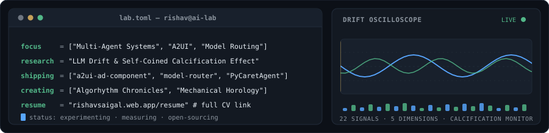
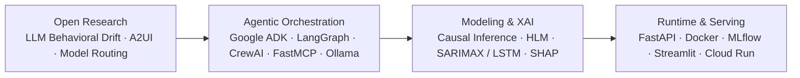

<!-- ═══════════════════════════════════════════════════════════════ -->
<!--    KINETIC AI SYSTEMS LAB — ANIMATED BUILDER PROFILE (NO CV)   -->
<!-- ═══════════════════════════════════════════════════════════════ -->

  <picture>
    <source media="(prefers-color-scheme: dark)" srcset="./assets/hero-dark.svg" />
    <source media="(prefers-color-scheme: light)" srcset="./assets/hero-light.svg" />
    
  </picture>

   

  <!-- Animated Typing Telemetry Banner (Dark / Light Adaptive) -->
  <a href="https://rishavsaigal.web.app/">
    <picture>
      <source media="(prefers-color-scheme: dark)" srcset="https://readme-typing-svg.demolab.com?font=JetBrains+Mono&weight=700&size=19&duration=2600&pause=850&color=58A6FF&center=true&vCenter=true&width=780&lines=Building+Autonomous+Multi-Agent+AI+Systems;Quantifying+LLM+Behavioral+Drift+%26+Calcification;FastMCP+%C2%B7+Google+ADK+%C2%B7+LangGraph+%C2%B7+A2UI;Open-Source+AI+Tooling+%26+Zenodo+Benchmarks;Creator+%40+Algorhythm+Chronicles+%C2%B7+Mechanical+Horology" />
      <source media="(prefers-color-scheme: light)" srcset="https://readme-typing-svg.demolab.com?font=JetBrains+Mono&weight=700&size=19&duration=2600&pause=850&color=0F2942&center=true&vCenter=true&width=780&lines=Building+Autonomous+Multi-Agent+AI+Systems;Quantifying+LLM+Behavioral+Drift+%26+Calcification;FastMCP+%C2%B7+Google+ADK+%C2%B7+LangGraph+%C2%B7+A2UI;Open-Source+AI+Tooling+%26+Zenodo+Benchmarks;Creator+%40+Algorhythm+Chronicles+%C2%B7+Mechanical+Horology" />
      
    </picture>
  </a>

    

  <!-- Single Unified Link Dock (Resume as link-only pointer, never duplicated in footer) -->
  
  
  
  
  
  
  
  
  

 

<!-- Animated Lab Terminal + 22-Signal Drift Oscilloscope -->

  <picture>
    <source media="(prefers-color-scheme: dark)" srcset="./assets/lab-console-dark.svg" />
    <source media="(prefers-color-scheme: light)" srcset="./assets/lab-console-light.svg" />
    
  </picture>

---

### 🧪 Open-Source Workshop & Research Labs

<table>
<tr>
<td width="50%" valign="top">

#### ⚡ [`a2ui-ad-component`](https://github.com/Rishav1996/a2ui-ad-component)

Decouples sponsored UI slots from LLM reasoning kernels via FastMCP + Google A2UI, preserving neutral reasoning in conversational AI.

[Code](https://github.com/Rishav1996/a2ui-ad-component) · [Paper](https://www.towardsdeeplearning.com/the-300b-search-dilemma-decoupling-commercial-components-from-llm-reasoning-in-conversational-ai-e41c3d2d5152) · 

</td>
<td width="50%" valign="top">

#### 🚀 [`model-router`](https://github.com/Rishav1996/model-router)

Two-axis routing skill scoring *capability floor* and *cost exposure* separately to pick the right model without premature upgrades.

[Code](https://github.com/Rishav1996/model-router) · [Paper](https://www.towardsdeeplearning.com/claude-model-routing-stop-scoring-complexity-score-these-two-things-instead-a6505c9053ce) · 

</td>
</tr>
<tr>
<td width="50%" valign="top">

#### 🔬 [`LLMDriftExperiment`](https://github.com/Rishav1996/LLMDriftExperiment)

Adversarial multi-agent debate benchmark tracking 22 signals across 5 dimensions to measure stance drift and a **self-coined calcification effect**.

[Code](https://github.com/Rishav1996/LLMDriftExperiment) · [Paper](https://medium.com/towards-artificial-intelligence/measuring-behavioral-drift-in-llms-22-signals-5-dimensions-and-the-calcification-effect-aeaeb904d096) · 

</td>
<td width="50%" valign="top">

#### 🤖 [`PyCaretAgent`](https://github.com/Rishav1996/PyCaretAgent)

Supervisor + ML Sub-Agents (`Classification`, `Regression`, `Clustering`, `TimeSeries`) with retry loops and FastAPI + Dockerfile emission.

[Explore Repository →](https://github.com/Rishav1996/PyCaretAgent)

</td>
</tr>
</table>

<strong>⚙️ More Open-Source Labs (4 Additional Repositories)</strong>

 

| Repository | What It Builds |
|:---|:---|
| [**`CognitoEDA`**](https://github.com/Rishav1996/CognitoEDA) | Autonomous multi-agent exploratory data analysis with **LangGraph + Gemini + Streamlit** |
| [**`AI-MLOps-TimeSeries`**](https://github.com/Rishav1996/AI-MLOps-TimeSeries) | Self-hosted forecasting sandbox (**SARIMAX, Prophet, LSTM**) with Celery, Redis, MLflow & drift triggers |
| [**`PyCaret-MLOps`**](https://github.com/Rishav1996/PyCaret-MLOps) | Containerized training and automated inference pipelines targeting **AWS & Hugging Face Spaces** |
| [**`AWS-ML-Services`**](https://github.com/Rishav1996/AWS-ML-Services) | Reference experiments across **AWS SageMaker**, **Comprehend** (NER), and **Transcribe** |

---

### 🧠 Lab Architecture & Kinetic Toolkit

   
  <picture>
    <source media="(prefers-color-scheme: dark)" srcset="https://skillicons.dev/icons?i=python,js,fastapi,docker,gcp,aws,azure,postgres,mysql,redis&theme=dark" />
    <source media="(prefers-color-scheme: light)" srcset="https://skillicons.dev/icons?i=python,js,fastapi,docker,gcp,aws,azure,postgres,mysql,redis&theme=light" />
    
  </picture>
    
  
  
  
  
  
  
  
  
  

---

### 🌊 Live Contribution Pulse & Kinetic Graphs

  <picture>
    <source media="(prefers-color-scheme: dark)" srcset="./assets/pulse-dark.svg" />
    <source media="(prefers-color-scheme: light)" srcset="./assets/pulse-light.svg" />
    
  </picture>

<!-- SNAKE-ANIM:START -->
<!-- Contribution snake renders automatically once Platane/snk runs in GitHub Actions -->
<!-- SNAKE-ANIM:END -->

<!-- CONTRIB-3D:START -->
<!-- 3D contribution skyline renders automatically once profile-3d-contrib workflow generates SVGs -->
<!-- CONTRIB-3D:END -->

---

### ✍️ Standalone Articles & *Algorhythm Chronicles*

<!-- WRITING-FEED:START -->
- **[The Specialized Frontier: An Inquiry into Gated AI Architectures and the Cooperative Safety Flywheel](https://pub.towardsai.net/the-specialized-frontier-an-inquiry-into-gated-ai-architectures-and-the-cooperative-safety-0f10f1546ad6)** — *Towards AI* · `Aug 2026`
- **[LangGraph Multi-Agent Architecture: Building a Self-Critiquing AI Debate System](https://pub.towardsai.net/langgraph-multi-agent-architecture-building-a-self-critiquing-ai-debate-system-971a7ad881d9)** — *Towards AI* · `May 2026`
- **[LLM Drift Explained: Do AI Models Lose Themselves Under Adversarial Pressure?](https://pub.towardsai.net/do-ai-models-lose-themselves-exploring-llm-drift-through-adversarial-debate-a37e0c75012b)** — *Towards AI* · `May 2026`
- **[The $1.5 Million Difference: Why Benchmarks are Only 10% of the AI Agent Story](https://www.linkedin.com/pulse/15-million-difference-why-benchmarks-only-10-ai-agent-rishav-saigal-ao4jc/)** — *LinkedIn* · `Mar 2026`
<!-- WRITING-FEED:END -->

<strong>📚 Earlier Standalone Writing (Archive)</strong>

 

<!-- WRITING-ARCHIVE:START -->
1. **[AutoML on Autopilot](https://pub.towardsai.net/automl-on-autopilot-c8939bca8f8f)** — *Towards AI* · `Mar 2026`
2. **[CognitoEDA](https://medium.com/@rishavsaigal/cognitoeda-bcbd3567e6d2)** — *Medium* · `Aug 2025`
3. **[Beyond Prediction: Generative AI's Probabilistic Future in Time Series](https://medium.com/@rishavsaigal/the-generative-ai-revolution-moving-beyond-what-will-happen-to-what-could-happen-in-time-f820ed5263f1)** — *Medium* · `Jun 2025`
4. **[Unlocking Time Series with LLMs: A New Era with TimeCAP](https://medium.com/@rishavsaigal/unlocking-time-series-with-llms-99a369f45447)** — *Medium* · `Jun 2025`
<!-- WRITING-ARCHIVE:END -->

 

<!-- YOUTUBE-FEED:START -->
<table><tr>
<td width="33%" align="center" valign="top">
  <a href="https://www.youtube.com/watch?v=Hl-kl_dAbCY">
     
    <b>Your Score – Predictive Classifiers &amp; Algorithmic Reality (Official Electronic Dance Music (EDM))</b> 2026-10-30
  </a>
</td>
<td width="33%" align="center" valign="top">
  <a href="https://www.youtube.com/watch?v=ZPIPP1_OR-A">
     
    <b>Fisher&#x27;s Son-in-Law – George Box &amp; Response Surface Methodology (Official Heartland Rock)</b> 2026-10-30
  </a>
</td>
<td width="33%" align="center" valign="top">
  <a href="https://www.youtube.com/watch?v=FjOP3rywxVQ">
     
    <b>The Binary of Being – David Cox, Joseph Berkson &amp; Logistic Regression (Official Dark Electronic Pop)</b> 2026-10-30
  </a>
</td>
</tr></table>
<!-- YOUTUBE-FEED:END -->

---

### 🏅 Live Credly Digital Badges

<!-- CREDLY-BADGES:START -->

  &nbsp;
  &nbsp;
  &nbsp;
  &nbsp;
  &nbsp;
  &nbsp;
  &nbsp;
  &nbsp;
  

<b>9 Live Credly Digital Badges</b> · Auto-synced via GitHub Actions · Click any badge to verify

<!-- CREDLY-BADGES:END -->

---

  
    <a href="https://github.com/Rishav1996/Rishav1996/issues/new?template=ama.yml"><b>Ask an Architecture / Research Question (GitHub AMA)</b></a> ·
    <a href="https://rishavsaigal.web.app/llms.txt"><b>AI-Agent Manifest (llms.txt)</b></a>
  

 

  <picture>
    <source media="(prefers-color-scheme: dark)" srcset="./assets/footer-dark.svg" />
    <source media="(prefers-color-scheme: light)" srcset="./assets/footer-light.svg" />
    
  </picture>

