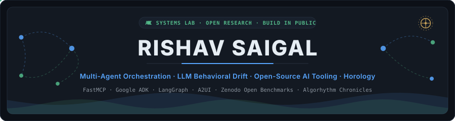
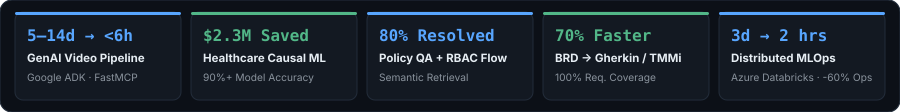
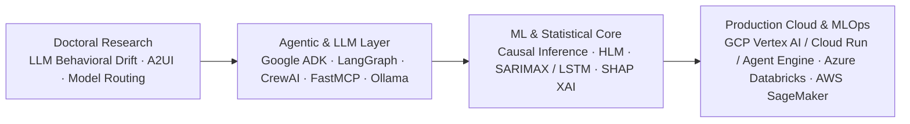
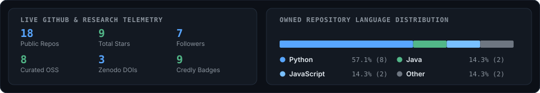

<!-- ═══════════════════════════════════════════════════════════════ -->
<!--    EXECUTIVE STUDIO PROFILE — ORDER A + THEME 1 (ZERO-DUP)     -->
<!-- ═══════════════════════════════════════════════════════════════ -->

  <picture>
    <source media="(prefers-color-scheme: dark)" srcset="./assets/hero-dark.svg" />
    <source media="(prefers-color-scheme: light)" srcset="./assets/hero-light.svg" />
    
  </picture>

    

  
  
  
  
  
  
  
  
  

---

### ⚡ Production Impact & Executive Scope

  <picture>
    <source media="(prefers-color-scheme: dark)" srcset="./assets/kpi-dark.svg" />
    <source media="(prefers-color-scheme: light)" srcset="./assets/kpi-light.svg" />
    
  </picture>

> [!NOTE]
> **Enterprise & Doctoral Scope:** Designated Subject Matter Expert (SME) in AI Architecture Design & GenAI at **Cognizant** (`Manager`, Kolkata), leading multi-agent roadmaps on GCP, RFP solutioning, campus-to-corporate fresher mentorship, and lateral technical hiring panels. **Ph.D. Candidate in CSE** at **IIT Patna** (`Jul 2026 – Jun 2029 Expected`; M.Tech DS&E, **BITS Pilani**; B.Tech CSE, **RCCIIT / MAKAUT**) investigating LLM behavioral drift, adversarial debate dynamics, autonomous ML orchestration, probabilistic LLM time series, and a **self-coined calcification effect** in multi-agent systems.

---

### 🔬 DOI-Indexed Research Artifacts (`Paper ↔ Code ↔ Zenodo`)

| Artifact | Research Contribution | Links |
|:---|:---|:---|
| **A2UI Commercial Component** | Decouples sponsored UI components from LLM reasoning kernels via **FastMCP + Google A2UI**, preserving reasoning neutrality (*The $300B Search Dilemma*, *Nov 2026*) | [**Code**](https://github.com/Rishav1996/a2ui-ad-component) · [**Paper**](https://www.towardsdeeplearning.com/the-300b-search-dilemma-decoupling-commercial-components-from-llm-reasoning-in-conversational-ai-e41c3d2d5152) ·  |
| **Claude Model Router** | Two-axis routing engine scoring *capability floor* and *cost exposure* separately for Claude Code (*Jul 2026*) | [**Code**](https://github.com/Rishav1996/model-router) · [**Paper**](https://www.towardsdeeplearning.com/claude-model-routing-stop-scoring-complexity-score-these-two-things-instead-a6505c9053ce) ·  |
| **LLM Drift Experiment** | Multi-agent adversarial debate framework quantifying behavioral drift & a **self-coined calcification effect** across 22 signals & 5 dimensions (*May 2026*) | [**Code**](https://github.com/Rishav1996/LLMDriftExperiment) · [**Paper**](https://medium.com/towards-artificial-intelligence/measuring-behavioral-drift-in-llms-22-signals-5-dimensions-and-the-calcification-effect-aeaeb904d096) ·  |

<strong>🛠️ Engineering & MLOps Open-Source Builds (5 Additional Repositories)</strong>

 

| Repository | Architecture & Stack |
|:---|:---|
| [**PyCaretAgent**](https://github.com/Rishav1996/PyCaretAgent) | Supervisor + ML Sub-Agents (`Classification`, `Regression`, `Clustering`, `TimeSeries`) built on **Google ADK** with self-correction loops, FastAPI & Docker generation |
| [**CognitoEDA**](https://github.com/Rishav1996/CognitoEDA) | Multi-agent automated exploratory data analysis pipeline powered by **LangGraph + Gemini + Streamlit** |
| [**AI-MLOps-TimeSeries**](https://github.com/Rishav1996/AI-MLOps-TimeSeries) | Self-hosted enterprise forecasting platform (**SARIMAX, Prophet, LSTM**) with Celery workers, Redis caching, MLflow registry & automated drift triggers |
| [**PyCaret-MLOps**](https://github.com/Rishav1996/PyCaret-MLOps) | Automated training, containerization, and CI/CD inference pipelines deploying to **AWS & Hugging Face Spaces** |
| [**AWS-ML-Services**](https://github.com/Rishav1996/AWS-ML-Services) | Production reference POCs for **AWS SageMaker**, **Comprehend** (NER/sentiment), and **Transcribe** (97.25% short-text accuracy) |

---

### ✍️ Standalone Technical Writing (Auto-Synced Feed + Archive)

<!-- WRITING-FEED:START -->
- **[The Specialized Frontier: An Inquiry into Gated AI Architectures and the Cooperative Safety Flywheel](https://pub.towardsai.net/the-specialized-frontier-an-inquiry-into-gated-ai-architectures-and-the-cooperative-safety-0f10f1546ad6)** — *Towards AI* · `Aug 2026`
- **[LangGraph Multi-Agent Architecture: Building a Self-Critiquing AI Debate System](https://pub.towardsai.net/langgraph-multi-agent-architecture-building-a-self-critiquing-ai-debate-system-971a7ad881d9)** — *Towards AI* · `May 2026`
- **[LLM Drift Explained: Do AI Models Lose Themselves Under Adversarial Pressure?](https://pub.towardsai.net/do-ai-models-lose-themselves-exploring-llm-drift-through-adversarial-debate-a37e0c75012b)** — *Towards AI* · `May 2026`
- **[The $1.5 Million Difference: Why Benchmarks are Only 10% of the AI Agent Story](https://www.linkedin.com/pulse/15-million-difference-why-benchmarks-only-10-ai-agent-rishav-saigal-ao4jc/)** — *LinkedIn* · `Mar 2026`
<!-- WRITING-FEED:END -->

<strong>📚 Earlier Standalone Publications (Complete Archive)</strong>

 

<!-- WRITING-ARCHIVE:START -->
1. **[AutoML on Autopilot](https://pub.towardsai.net/automl-on-autopilot-c8939bca8f8f)** — *Towards AI* · `Mar 2026`
2. **[CognitoEDA](https://medium.com/@rishavsaigal/cognitoeda-bcbd3567e6d2)** — *Medium* · `Aug 2025`
3. **[Beyond Prediction: Generative AI's Probabilistic Future in Time Series](https://medium.com/@rishavsaigal/the-generative-ai-revolution-moving-beyond-what-will-happen-to-what-could-happen-in-time-f820ed5263f1)** — *Medium* · `Jun 2025`
4. **[Unlocking Time Series with LLMs: A New Era with TimeCAP](https://medium.com/@rishavsaigal/unlocking-time-series-with-llms-99a369f45447)** — *Medium* · `Jun 2025`
<!-- WRITING-ARCHIVE:END -->

---

### 🧠 System Architecture Map

<strong>⚙️ Full Technical Capabilities Matrix (Monochrome Spec)</strong>

 

| Domain | Verified Technologies & Competencies |
|:---|:---|
| **Generative & Agentic AI** | Generative AI (GenAI), Large Language Models (LLMs), Agentic AI, Multi-Agent Systems, Retrieval-Augmented Generation (RAG), Prompt Engineering, Google ADK, LangGraph, CrewAI, LangChain, FastMCP, Hugging Face, Ollama |
| **ML & Statistical Modeling** | Scikit-Learn, TensorFlow, Keras, PyCaret, SHAP / Explainable AI (XAI), Transfer Learning, Survival Analysis, Causal Inference, Time Series Forecasting, Hierarchical Linear Models (HLM) |
| **MLOps, Data & APIs** | MLflow, DataRobot, Azure Databricks, Docker, CI/CD for ML, Model Monitoring, Automated Retraining, Feature Engineering, PySpark, Dask, FastAPI, Flask, PostgreSQL, MySQL, Redis, Streamlit, Plotly |
| **Cloud Platforms** | GCP (`Vertex AI`, `Cloud Run`, `Gemini Enterprise`, `Agent Engine Platform`), AWS (`SageMaker`, `Lambda`, `ECS`, `Transcribe`, `Comprehend`), Azure ML |

---

### 📜 Verified Credentials Vault (`15 Total · Auto-Synced`)

<!-- CREDLY-BADGES:START -->

  &nbsp;
  &nbsp;
  &nbsp;
  &nbsp;
  &nbsp;
  &nbsp;
  &nbsp;
  &nbsp;
  

<b>9 Live Credly Digital Badges</b> · Auto-synced from Credly · Click any badge to verify

<!-- CREDLY-BADGES:END -->

<strong>🎓 Specialized Academy Certifications (6 Verified Credentials · Microsoft & Dataiku)</strong>

 

| Credential | Issuer | Issued | Verification |
|:---|:---|:---:|:---|
| **Generative AI Practitioner Certificate** | Dataiku Academy | Jun 2026 | [**[Verify]**](https://verify.skilljar.com/c/hg2aiksrvrt2) |
| **Microsoft Certified: Azure AI Fundamentals** | Microsoft | Jun 2025 | [**[Verify]**](https://learn.microsoft.com/en-us/users/rishavsaigal-8851/credentials/3d9e3e8e7a0cb39d) |
| **MLOps Practitioner Certificate** | Dataiku Academy | Aug 2023 | [**[Verify]**](https://verify.skilljar.com/c/7djsjp74vdvj) |
| **Advanced Designer Certificate** | Dataiku Academy | Jul 2023 | [**[Verify]**](https://verify.skilljar.com/c/weie95jezjyz) |
| **ML Practitioner Certificate** | Dataiku Academy | Jul 2023 | [**[Verify]**](https://verify.skilljar.com/c/2hph8ogspvy5) |
| **Core Designer Certificate** | Dataiku Academy | Jul 2023 | [**[Verify]**](https://verify.skilljar.com/c/4ucupx9wj33r) |

---

### 📡 Live Telemetry & Algorhythm Media

  <picture>
    <source media="(prefers-color-scheme: dark)" srcset="./assets/telemetry-dark.svg" />
    <source media="(prefers-color-scheme: light)" srcset="./assets/telemetry-light.svg" />
    
  </picture>

<!-- CONTRIB-3D:START -->
<!-- 3D contribution skyline renders automatically once profile-3d-contrib workflow generates SVGs -->
<!-- CONTRIB-3D:END -->

#### 🎬 Latest from *Algorhythm Chronicles*

<!-- YOUTUBE-FEED:START -->
<table><tr>
<td width="33%" align="center" valign="top">
  <a href="https://www.youtube.com/watch?v=Hl-kl_dAbCY">
     
    <b>Your Score – Predictive Classifiers &amp; Algorithmic Reality (Official Electronic Dance Music (EDM))</b> 2026-10-30
  </a>
</td>
<td width="33%" align="center" valign="top">
  <a href="https://www.youtube.com/watch?v=ZPIPP1_OR-A">
     
    <b>Fisher&#x27;s Son-in-Law – George Box &amp; Response Surface Methodology (Official Heartland Rock)</b> 2026-10-30
  </a>
</td>
<td width="33%" align="center" valign="top">
  <a href="https://www.youtube.com/watch?v=FjOP3rywxVQ">
     
    <b>The Binary of Being – David Cox, Joseph Berkson &amp; Logistic Regression (Official Dark Electronic Pop)</b> 2026-10-30
  </a>
</td>
</tr></table>
<!-- YOUTUBE-FEED:END -->

---

  
    Architecting autonomous systems that reason, evaluate, and self-correct at production scale ·
    <a href="https://github.com/Rishav1996/Rishav1996/issues/new?template=ama.yml"><b>Ask an Architecture / Research Question (AMA)</b></a> ·
    <a href="https://rishavsaigal.web.app/llms.txt"><b>AI-Agent Manifest (llms.txt)</b></a>
  

